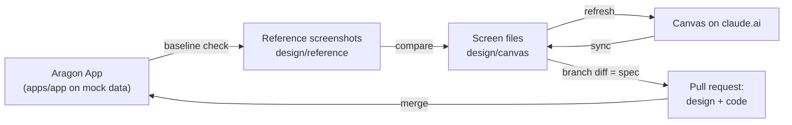

# Design canvas

A way to try visual changes to the Aragon App without touching app code, and to hand the chosen one to engineering as a
diff.

- Each app screen is redrawn as one HTML file that mounts the real `@aragon/gov-ui-kit` components on mock data.
  Together these screens are the **baseline**: the app as it looks today.
- The files live here in git, which is the source of truth. People view and edit them on a claude.ai **canvas**, a
  board with one frame per screen. The canvas cannot read from or write to GitHub: a Claude Code session copies files
  in either direction when asked.
- A design idea is a branch that changes only `design/canvas/`. If it is dropped, delete the branch and nothing else
  changed. If it is picked, its diff against the baseline is what engineering builds, in the same pull request.

`design/` is not a workspace. Nothing in it is built, deployed or released, and no CI job reads it.

**Status (17 November 2026): pilot.** 4 of about 40 screens are redrawn, plus 3 shared parts. The baseline lives on the
branch `claude/eloquent-cori-mv7xrx` until it is merged to `main`. See [Status](#status).

## Links and access

| What | Link |
|---|---|
| Baseline canvas | https://claude.ai/artifact/9gVpqYZDyCe6ksmjvvkA54 |
| Design system the screens are built with | [Aragon Governance UI Kit](https://claude.ai/artifact/BMrtaZwNQzvBsTyH9KvHMC), synced from `packages/gov-ui-kit` |

Both links are private: they open only for people the owner has shared them with from the page's Share menu. Ask the
canvas owner (the design lead) for access. This repository is public, so everything in `design/`, including the screens of an exploration branch, is
public as soon as it is pushed.

## How it fits together

| Term | Meaning |
|---|---|
| Screen | One app page redrawn as a `.dc.html` file; one frame on the canvas |
| Canvas | The claude.ai page where screens are viewed, edited by hand, commented on and shared |
| Baseline | The screens that mirror the app as it is. Lives on `main` once merged |
| Exploration | A branch off the baseline, with its own canvas, where a design idea is tried |
| Sync | Canvas → repo: hand edits made on the canvas are committed to the branch |
| Refresh | Repo → canvas: the branch's files are published to its canvas |
| The kit | `@aragon/gov-ui-kit`. Its claude.ai copy is "the design system"; a canvas uses a pinned version of it |

## Who does what

| Role | Does |
|---|---|
| Designer (owner) | Starts explorations, edits on the canvas or asks Claude, says when a design is ready, decides what a difference between app and baseline means |
| Claude Code session | Moves files between canvas and repo, edits screens when asked, runs the checks. It commits to the branch; it opens no pull request and creates no branch without the owner's OK. Steps: [RUNBOOK.md](RUNBOOK.md) |
| Engineer | Builds the design in `apps/app` from the branch diff, in the same pull request |
| Reviewer (`@aragon/app-team`) | Reviews the pull request: screen diff and code together |

## Exploring a design

1. Tell Claude what you want to explore and from which screens ("new exploration: proposals filter, from the Proposals
   screen"). With your OK it creates the branch `exploration/<name>` and a canvas for it.
2. Change the screens: edit on the canvas yourself (retype text, restyle, move, duplicate a frame to try a variant), or
   ask Claude in the session or in a canvas comment.
3. Say "sync" whenever you want the canvas state kept in git. Any earlier state can be restored from git.
4. When it is ready: keep the chosen version in the original screen file and delete the variants, then sync. The
   branch diff is now the design.

## Handing a design to engineering

1. The engineer gets the branch name, the exploration's canvas link (shared with them), and
   `git diff <baseline>...exploration/<name> -- design/canvas`.
2. Reading the diff:
   - `<x-import component-from-global-scope="GovUiKit.Button" variant="primary">` is `<Button variant="primary">` from
     the kit; attributes are the props in kebab case.
   - Plain elements with classes from `app.css`, or with inline styles, are app layout; `app.css` names the app source
     each rule mirrors. Write them with the app's own classes.
   - The `renderVals()` block is mock data and `canvas.json` is board layout. Neither is spec.
3. The diff does not show loading, empty or error states, widths that were not drawn, translation keys or behaviour.
   Ask the designer.
4. Build in `apps/app` on the same branch, or one based on it. One pull request carries the screens and the code. The
   app needs its changeset as usual; a change to a kit component is a kit change with its own changeset (root
   `AGENTS.md`, Releases) and is listed in the pull request.
5. If the build ends up different from the design, change the screen to match before merging.
6. After the merge, `design/canvas/` on `main` is the new baseline. Still to do by hand: refresh the baseline canvas
   from `main`, remove the exploration's file from `design/canvases/`, delete its canvas, and retake the affected
   reference screenshots at the next baseline check.

Example. "Move the proposals filter into the page header": the designer asks for the exploration
`exploration/proposals-filter`; Claude creates the branch and its canvas; the designer edits `Proposals` on the canvas
and says "sync"; the branch diff shows one changed file, `design/canvas/Proposals.dc.html`; the engineer builds the
change in `apps/app/src/modules/governance` on the same branch and opens the pull request; after review and merge the
baseline canvas is refreshed from `main`.

## Rules

- An exploration changes only `design/canvas/` and its own file in `design/canvases/`.
- Reference screenshots change only in a baseline check, never in a feature pull request (binary files cannot be
  merged).
- Never upload an image to a canvas. Images are files: app-owned ones are listed in `screens.json`, design-only ones
  live in `design/canvas/assets/`.
- A canvas is only refreshed after it has been synced, so hand edits are never overwritten.
- The kit version of a canvas changes only on purpose, in a commit that says so.

## Checking the baseline against the app

Owner: the design lead. When: before an exploration starts from a screen, and after a release that changed the UI. Manual for now.

1. Run the app on mock data and retake the screenshots into a scratch folder ([baseline-check](baseline-check/README.md)).
2. For each screen in the Status table, compare the new screenshot with the committed one and with the screen
   (`compare.cjs` prints the differences). A difference means either the app changed on purpose (update the screen and
   the reference) or the app is wrong (file a bug; leave both as they are).
3. Commit the updated references together with the screen fixes.

## Status

| Screen | File | App route | Reference | Match at 1440 px | At 390 px |
|---|---|---|---|---|---|
| Explore | `Main.dc.html` | `/` | `explore.webp` | same height, 0.4% of pixels differ | same height, 0.4% |
| DAO dashboard | `Dashboard.dc.html` | `/dao/…/dashboard` | `dao-dashboard.webp` | same height, 0.0% | same height, 0.0% |
| Proposals | `Proposals.dc.html` | `/dao/…/proposals` | `dao-proposals.webp` | same height, 0.0% | no reference |
| Proposal detail (active) | `Proposal.dc.html` | `/dao/…/proposals/MGP-8` | `dao-proposal-mgp-8-active.webp` | same height, 0.5% (the proposal body, see Known gaps) | no reference |

Shared parts: `Sidebar.dc.html` (DAO navigation: sidebar, and the top bar that replaces it on small screens),
`Footer.dc.html`, `AragonLogo.dc.html`, and `app.css` (the app's page layout).

Not redrawn yet (reference screenshots exist): the other proposal states, members and member detail, assets,
transactions, permissions, settings, the multisig DAO, the create wizards (DAO, proposal, process, workspace), the
workspace pages, dialogs, and the not-found pages. Links to screens that do not exist yet go nowhere.

## Footprint

- Size: about 7 MB in total, of which 6.6 MB are the 95 reference screenshots (lossless WebP). A retake
  changes only the screenshots whose page changed.
- Code: `baseline-check/` is about 2,700 lines of plain Node scripts (a mock of the backend API and JSON-RPC, the
  screenshot runs, the canvas comparison). It mirrors the backend's response shapes by hand, so it needs an update when
  those change. It declares no dependencies of its own: it uses Playwright, viem and sharp from `apps/app`. Whether it
  should move next to the app's e2e setup (`apps/app/e2e`) is an open question for the app team.
- CI: none. `design/` is in no workspace, Turbo task, path filter or release scope. Biome lints `baseline-check/` in the
  pre-commit hook and skips `canvas/` (written by the canvas editor, kept byte-identical) and `reference/`.
- Removing it: delete `design/`, the `design/` lines in `.gitattributes` and `.editorconfig`, and the bullet in the root
  `AGENTS.md`. Nothing else refers to it.

## Folder layout

| Path | What |
|---|---|
| `canvas/canvas.json` | The board: every frame, its position and size, and the design system in use |
| `canvas/*.dc.html` | One file per screen or shared part |
| `canvas/app.css` | The app's page layout around the kit components, transcribed from `apps/app` |
| `canvas/assets/` | Images that exist only in designs (mock avatars and token logos) |
| `canvases/*.json` | One file per canvas: its branch, link, last synced version, and the pinned kit version with file hashes |
| `screens.json` | Screen ↔ app route ↔ reference screenshot, the reference time of the mock data, and app-owned images the screens use |
| `reference/*.webp` | Full-page screenshots of the real app on mock data |
| `baseline-check/` | Runs the app on mock data, takes the screenshots, renders the screens and compares them |
| `RUNBOOK.md` | Step-by-step procedures for the Claude session (or a person) operating this |

Related, and not the same thing: `packages/gov-ui-kit/design-system/` (how the kit is synced to the design system) and
`.design-sync/` (kit token parity).

## Known gaps

- The kit bundle and the canvas runtime are not in git. Rebuilding a canvas, or comparing screens with screenshots,
  needs the design system at the pinned version and a Claude session to fetch both. The pin and the file hashes are in
  `canvases/baseline.json`.
- `app.css` is a hand-kept copy of the app's page layout. It is checked against the app by the comparison, not
  generated from it.
- Inside a page, the app sizes components by the width of the content column; on the canvas the kit sizes them by the
  window. Screens match at 1440 px and at 390 px; widths in between can differ.
- Labels such as "3 days left" are computed by the kit from the viewer's clock. The screens give dates as offsets from
  now, so these labels always read as in the reference; absolute dates are fixed text.
- Proposal detail: the app shows the headings of a proposal body as plain text, while the kit component styles them.
  This is unconfirmed app behaviour on `main` (possibly from the pending stylesheet change), to be checked with the app
  team. The screen shows the kit's styling.
- Proposal detail: the Votes and Settings tabs of the voting block are not drawn. Explore: the Featured row is one
  still frame of the app's moving carousel.
