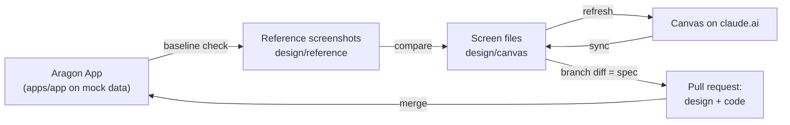

# Design canvas

A way to try visual changes to the Aragon App without touching app code, and to hand the chosen one to engineering as a
diff.

- Each app screen is redrawn as one HTML file that mounts the real `@aragon/gov-ui-kit` components on mock data.
  Together these screens are the **baseline**: the app as it looks today.
- The files live here in git, which is the source of truth. People view and edit them on a claude.ai **canvas**, a
  board with one frame per screen. The canvas cannot read from or write to GitHub: a Claude Code session copies files
  in either direction when asked.
- A design idea is a branch that changes the screens (`design/canvas/`, plus `screens.json` when it adds a screen)
  and nothing in the app. If it is dropped, delete the branch and nothing else changed. If it is picked, its diff
  against the baseline is what engineering builds, adding the app code to the same branch and pull request.

`design/` is not a workspace. Nothing in it is built, deployed or released, and no CI job reads it.

**Status (17 November 2026): baseline complete, not yet merged.** All 121 reference screenshots of the app are redrawn
(118 desktop screens, 2 of them also at phone width, and one phone-only dialog: 119 screens), plus 11 shared parts. The baseline
lives on the branch `docs/design-canvas` until it is merged to `main`. See [Status](#status).

## Links and access

| What | Link |
|---|---|
| Baseline canvas | https://claude.ai/artifact/9gVpqYZDyCe6ksmjvvkA54 |
| Design system the screens are built with | [Aragon Governance UI Kit](https://claude.ai/artifact/BMrtaZwNQzvBsTyH9KvHMC), synced from `packages/gov-ui-kit` |

Both links are private: they open only for people the owner has shared them with from the page's Share menu. Ask the
canvas owner (the design lead) for access. This repository is public, so everything in `design/`, including the screens of an exploration branch, is
public as soon as it is pushed.

## How it fits together

| Term | Meaning |
|---|---|
| Screen | One app page or state (a wizard step, an open dialog) redrawn as a `.dc.html` file; one frame on the canvas (a "board" or "artboard" in the files) |
| Shared part | A `.dc.html` file that screens mount, such as the sidebar or the footer. Changing it changes every screen that uses it |
| Canvas | The claude.ai page where screens are viewed, edited by hand, commented on and shared |
| Baseline | The screens that mirror the app as it is. Lives on `main` once merged |
| Exploration | A branch off the baseline, with its own canvas, where a design idea is tried |
| Sync | Canvas → repo: hand edits made on the canvas are committed to the branch |
| Refresh | Repo → canvas: the branch's files are published to its canvas |
| The kit | `@aragon/gov-ui-kit`. Its claude.ai copy is "the design system"; a canvas uses a pinned version of it |
| Pointer file | `design/canvases/<name>.json`: which canvas belongs to which branch, its last synced version, and its kit pin |
| Stand-in | Markup an exploration draws in place of a kit component it wants to change (kit components cannot be edited on a canvas) |

## Who does what

| Role | Does |
|---|---|
| Designer (owner) | Starts explorations, edits on the canvas or asks Claude, says when a design is ready, decides what a difference between app and baseline means |
| Claude Code session | Moves files between canvas and repo, edits screens when asked, runs the checks. It commits to the branch; it opens no pull request and creates no branch without the owner's OK. Steps: [RUNBOOK.md](RUNBOOK.md) |
| Engineer | Builds the design in `apps/app` from the branch diff, in the same pull request |
| Reviewer (`@aragon/app-team`) | Reviews the pull request: screen diff and code together |

## Exploring a design

1. Tell Claude what you want to explore and from which screens ("new exploration: proposals filter, from the Proposals
   screen"). With your OK it creates the branch `exploration/<name>` and a canvas for it.
2. Change the screens: edit on the canvas yourself (retype text, restyle, duplicate a frame to try a variant), or
   ask Claude in the session or in a canvas comment. A duplicated frame is a new screen file; Claude gives it a row
   when it syncs. Arranging frames is done in `screens.json` → `pages`: frames moved by hand go back to their rows
   at the next layout run, unless you ask Claude to keep the new arrangement.
3. Say "sync" whenever you want the canvas state kept in git. Any earlier state can be restored from git.
4. When it is ready: keep the chosen version in the original screen file and delete the variants, then sync. Claude
   replaces raw values from hand edits with kit tokens where one exists and checks every screen still renders. The
   branch diff is now the design.

## Handing a design to engineering

1. The engineer gets the branch name, the exploration's canvas link (shared with them), and
   `git diff <baseline>...exploration/<name> -- design/canvas`, where `<baseline>` is the branch the baseline lives on
   (`main` once this is merged).
2. Reading the diff:
   - `<x-import component-from-global-scope="GovUiKit.Button" variant="primary">` is `<Button variant="primary">` from
     the kit; attributes are the props in kebab case.
   - Plain elements with classes from `app.css`, or with inline styles, are app layout; `app.css` names the app source
     each rule mirrors. Write them with the app's own classes.
   - The `renderVals()` block is mock data and `canvas.json` is board layout. Neither is spec.
3. The diff does not show loading, empty or error states, widths that were not drawn, translation keys or behaviour.
   Ask the designer.
4. Build in `apps/app` on the same branch, or one based on it. One pull request carries the screens and the code. The
   app needs its changeset as usual; a change to a kit component is a kit change with its own changeset and a
   refreshed component registry (root `AGENTS.md`, Releases) and is listed in the pull request.
   If the design changed a kit component, the screens hold stand-ins for it. The same pull request changes the kit
   component, moves the canvas (and the baseline's kit pin) to the re-synced kit, puts the real component back, and
   proves it renders as the stand-in did (`compare.cjs --against`). Until then `compare.cjs` fails; it is run by
   hand today, not in CI.
5. If the build ends up different from the design, change the screen to match before merging.
6. Before the merge, the pull request deletes the exploration's pointer file (`design/canvases/<name>.json`), so
   `main` keeps only the baseline's.
7. After the merge, `design/canvas/` on `main` is the new baseline. By hand, in a Claude session: refresh the baseline
   canvas from `main` so it shows the merged screens, and ask the owner whether to delete the exploration's canvas. The
   reference screenshots of the changed pages are now out of date: the next baseline check retakes them from the app,
   which by then matches the screens.

Example. "Move the proposals filter into the page header": the designer asks for the exploration
`exploration/proposals-filter`; Claude creates the branch and its canvas; the designer edits `Proposals` on the canvas
and says "sync"; the branch diff shows one changed file, `design/canvas/Proposals.dc.html`; the engineer builds the
change in `apps/app/src/modules/governance` on the same branch and opens the pull request; after review and merge the
baseline canvas is refreshed from `main`.

## Rules

- An exploration changes only `design/canvas/`, `screens.json` (screens it adds, and their rows) and its own pointer
  file. It may delete screens it does not need on its canvas, but restores them before handover, or the merge would
  delete them from the baseline.
- Reference screenshots change only in a baseline check, never in a feature pull request (binary files cannot be
  merged).
- Never upload an image to a canvas. Images are files: app-owned ones are listed in `screens.json`, design-only ones
  live in `design/canvas/assets/`.
- A canvas is only refreshed after it has been synced, so hand edits are never overwritten.
- The kit version of a canvas changes only on purpose, in a commit that says so.
- Kit components cannot be edited on a canvas. An exploration that changes one draws a marked stand-in in its place
  (`data-stands-in-for`); `compare.cjs` fails while any stand-in is left, so the pull request that implements the
  design must change the kit component and put the real one back ([RUNBOOK.md](RUNBOOK.md), Handover).
- Frame positions in `canvas.json` come from `screens.json` → `pages`: a screen goes on a row there, and
  `baseline-check/layout-canvas.cjs` places it.

## Checking the baseline against the app

Owner: the design lead. When: before an exploration starts from a screen, and after a release that changed the UI.
Manual for now; a Claude session runs it ([RUNBOOK.md](RUNBOOK.md), Checking the baseline).

1. Run the app on mock data and retake every screenshot ([baseline-check](baseline-check/README.md)).
2. With the fixed clock, an unchanged app gives byte-identical files on the same machine and browser build, so git
   shows exactly the screenshots whose page changed.
3. For each one, the owner decides: the app changed on purpose (keep the new screenshot, update the screen until
   `compare.cjs` passes) or the app is wrong (file a bug, restore the old screenshot).
4. Commit the screenshots and the screen fixes together.

## Status

Every reference screenshot has a screen; `screens.json` lists each one with its reference (and its app route where
the route alone opens it: 64 of 119; wizard steps, dialogs and seeded workspace pages are reached as described in the
capture scripts), and `baseline-check/compare.cjs` prints the current numbers. Every screen renders at exactly its
reference's height. Figures as of 17 November 2026:

| Canvas page | Screens | Differing pixels (at 1440 px; the phone-only dialog at 390 px) |
|---|---|---|
| DAO pages: explore, not-found, and each mock DAO's pages (Meridian, token voting; Atlas Grants Council, multisig; Northstar Protocol, two-stage with Safes; a Safe account) | 42 | 0.0–0.1% for most; explore 0.5%; the permissions graphs 0.3–0.6% (a still drawing of an interactive graph) |
| Proposals: every proposal state of each DAO, plus voting with a connected wallet | 24 | 0.0% |
| Wizards: create DAO, proposal (three DAO types), execute, governance process, workspace | 23 | 0.0–0.3% |
| Workspaces: all accounts, one account, connected, edit | 21 | 0.0–0.1% |
| Dialogs: wallet, asset picker, mobile navigation, the transaction dialogs | 9 | 0.0% for most; the wallet SDK modal 0.5%; publish DAO 0.9% (the page behind it is scrolled in the screenshot) |
| Components: the shared parts (sidebars, footer, logo, wizard frame, permission toolbars, transaction steps) | 11 parts | (used by the screens above) |

Mock data, three DAOs and a workspace, is described in [baseline-check/README.md](baseline-check/README.md). Clicking
through the canvas in Play mode follows the app: a link or button opens the drawn screen it opens in the app, staying
within the same DAO or workspace and the same wallet state, and buttons that open a dialog open the drawn dialog. A
list links every item to its one drawn example (all members to the member screen of that DAO). What does not link:
targets the canvas does not draw (the delegate and execute dialogs, the workspace governance-process page, later
wizard steps for the multisig and multistage DAOs), and kit controls that render no link (the kit's wallet button,
toggle tabs).

## Footprint

- Size: about 10 MB in git, of which 8.7 MB are the 121 reference screenshots (lossless WebP) and 1.2 MB the canvas
  (1.0 MB of it the 130 screen and part files).
  A retake changes only the screenshots whose page changed.
- Code: `baseline-check/` is about 5,900 lines of plain Node scripts, most of it mock data: a mock of the backend API,
  JSON-RPC and the Safe transaction service, the screenshot runs, the canvas comparison, the route coverage check and
  the canvas layout. It mirrors the backend's response shapes by hand, so it needs an update when those change. It
  declares no dependencies of its own: it uses Playwright and viem from `apps/app`, and sharp from the copy Next.js
  ships. Whether it should move next
  to the app's e2e setup (`apps/app/e2e`) is an open question for the app team.
- CI: none yet. `design/` is in no workspace, Turbo task, path filter or release scope. Biome lints `baseline-check/`
  in the pre-commit hook and skips `canvas/` (written by the canvas editor, kept byte-identical), `reference/` and the
  CMS snapshot.
- Removing it: delete `design/`, the `design/` lines in `.gitattributes` and `.editorconfig`, and in the root
  `AGENTS.md` the `design/` bullet and `design` in the list of nested Biome configs. Nothing else refers to it.

## Folder layout

| Path | What |
|---|---|
| `canvas/canvas.json` | The board: pages, every frame's position and size, row titles, and the design system in use. Positions are generated from `screens.json` → `pages` |
| `canvas/*.dc.html` | One file per screen or shared part |
| `canvas/app.css` | The app's page layout around the kit components, transcribed from `apps/app` |
| `canvas/assets/` | Images that exist only in designs (mock avatars and token logos); app-owned images are published from the app (`screens.json` → `appAssets`) |
| `canvases/*.json` | One file per canvas: its branch, link, last synced version, and the pinned kit version with file hashes |
| `screens.json` | Screen ↔ app route ↔ reference screenshot, the canvas pages and their rows, the reference time of the mock data, and app-owned images the screens use |
| `reference/*.webp` | Full-page screenshots of the real app on mock data |
| `baseline-check/` | Runs the app on mock data, takes the screenshots, renders the screens and compares them |
| `RUNBOOK.md` | Step-by-step procedures for the Claude session (or a person) operating this |

Related, and not the same thing: `packages/gov-ui-kit/design-system/` (how the kit is synced to the design system) and
`.design-sync/` (kit token parity).

## Known gaps

- The kit bundle and the canvas runtime are not in git. Rebuilding a canvas, or comparing screens with screenshots,
  needs the design system at the pinned version and a Claude session to fetch both. The pin and the file hashes are in
  `canvases/baseline.json`.
- `app.css` is a hand-kept copy of the app's page layout. It is checked against the app by the comparison, not
  generated from it.
- Inside a page, the app sizes components by the width of the content column; on the canvas the kit sizes them by the
  window. Screens are checked at 1440 px; three also at 390 px (the only phone screenshots). Other widths can differ.
- Labels such as "3 days left" are computed by the kit from the viewer's clock. The screens give dates as offsets from
  now, so these labels always read as in the reference; absolute dates are fixed text.
- Screens are still states: a dialog's transaction steps, an open menu, a vote being cast are each drawn as the one
  state the screenshot shows, and the canvas keeps no state between screens.
- What the kit derives from the connected wallet (the "You" tag on a member row, "by You") cannot happen on the canvas:
  those pieces are written out with the same kit components.
- The app shows proposal descriptions as plain text: the kit's document component styles headings, but the app's
  stylesheet has no typography styles for it. The screens match the app. Whether that is intended is a question for the
  app team.
- Not drawn: the Votes and Settings tabs of a proposal's voting block, the live permissions graph (drawn as a still
  picture), and the moving Explore carousel (one still frame). Automations and plugin pages have no screenshot (no mock
  DAO uses them; `baseline-check/check-routes.cjs` lists them as skipped).

## Room for improvement

Ideas that need this flow to have run for real at least once before they are worth building.

- **The design as the gate (TDD for UI).** A pull-request check that captures the app on mock data, renders the screens
  and fails while they differ. A designed change is red until the app matches the screens; an undesigned UI change
  is red until the code is reverted or the screens are updated to match, which shows up as a design diff in review.
  Needs per-screen tolerances for the few screens that cannot match exactly (still drawings of moving parts).
  It would run only on pull requests that change `apps/app/src`, `packages/gov-ui-kit/src` or `design/canvas`
  (`.github/filters.yml`), once they are ready for review, and only on the pages a change can affect where that can be
  told. Order: after the first exploration has gone from canvas to merged code, run it as a report that comments on
  the pull request; make it required (with the ownership rule below) once that report has proven trustworthy.
  Speed: rendering and comparing now runs several screens at once (about 8 minutes for all 121, from 24); capture
  and a production build of the app instead of `next dev` are the next steps.
- **Design review by ownership.** A CODEOWNERS entry on `design/canvas/` for the design lead, so a screen change in
  any pull request, including one made to follow the code, needs their approval.
- **No screenshots in git.** With the check above comparing the app with the screens directly, the reference
  screenshots stop being needed in the repository: CI keeps them as build artifacts. That removes 8.7 MB now and every
  future image change (each retake adds the changed images to history).
- **Automatic refresh.** Refreshing the baseline canvas after a merge to `main`, and the baseline check after a
  release, are manual today; both could run from a GitHub Action.
- **Feature flags as a tweak.** The screens show the app as it runs locally, with every flag that is on there (the
  workspace call to action and links, the Safe account page). One environment tweak on each screen (local, development,
  production), taking its values from the snapshot of the flags in `baseline-check/cms/feature-flags.json`, would let
  a designer see and design the other states. Only for flags that change what a drawn screen shows; the baseline check
  would then also capture those pages with production flags, so the flag-off states are verified too.
- **Copy from `en.json`.** Screens type the app's text in; nothing ties it to its translation key. Screens could look
  text up by key from a copy of `apps/app/src/assets/locales/en.json` published with the canvas, so app copy changes
  reach the canvas on their own and a copy change in a design shows up as a key in the diff. The cost: retyping text
  on the canvas becomes an edit of the key's value or an override.
